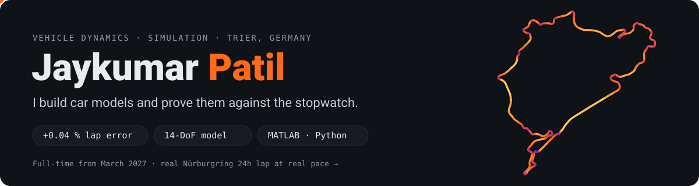
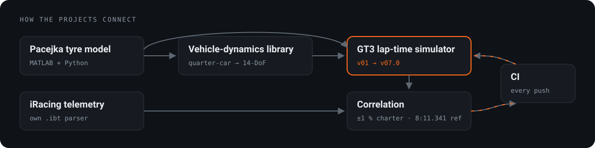

**Vehicle Dynamics & Simulation Engineer** · M.Sc. Interdisciplinary Engineering (Automotive), Hochschule Trier · Trier, Germany

I build and validate vehicle simulation tools: lap-time simulators, multi-DoF vehicle models and tyre models, correlated against telemetry. My current focus is hybrid powertrains. My Master's thesis covers modelling, energy management and component sizing for a hydrogen-fuelled rotary range extender in a series-hybrid EV.

**Open to full-time roles in Germany from March 2027**: vehicle dynamics, simulation, race engineering, hybrid/EV powertrain. As a graduate of a German university I can switch directly to a work permit (§ 18b AufenthG / EU Blue Card), so no employer sponsorship is needed.

---

## Featured projects

| Project | What it is | Stack |
|---|---|---|
| **[GT3 Lap Time Simulator](https://github.com/jaykumarpatil9099/gt3-lap-time-simulator)** · [live page](https://jaykumarpatil9099.github.io/gt3-lap-time-simulator/) | Quasi-steady-state lap simulator for the Mercedes-AMG GT3 at the Nürburgring 24h, calibrated against iRacing telemetry. Fidelity ladder from point mass up to Pacejka MF 5.2 with combined slip; calibrated v05 hits **+0.04 %** vs the reference lap. Pure-MATLAB `.ibt` parser, sector-RMS calibration sweep, sensitivity tornado. A charter regression test in CI keeps the lap within ±1 %. | MATLAB · CI |
| **[Vehicle Dynamics Models](https://github.com/jaykumarpatil9099/vehicle-dynamics-models-matlab-simulink)** | Simulink toolkit from quarter-car to 14-DoF full vehicle, plus bicycle, longitudinal drive/brake and a Pacejka library. Every model is smoke-tested in CI. | Simulink · CI |
| **[14-DoF Full-Vehicle Model](https://github.com/jaykumarpatil9099/vd-14dof-full-vehicle-matlab-simulink)** | Standalone 14-DoF ride + handling model: body, unsprung masses, wheel spin, 8-speed drivetrain, brakes, ARBs and per-axle Pacejka tyres. Frequency-domain results within ~2 % of hand calculations. | Simulink · CI |
| **[Pacejka Magic Formula](https://github.com/jaykumarpatil9099/pacejka-tyre-model)** | Load-sensitive Magic Formula tyre model in **MATLAB and Python**. Both versions are tested against the same reference values in CI. | MATLAB · Python · uv |
| **[Ackermann Steering Analysis](https://github.com/jaykumarpatil9099/ackermann-steering-analysis)** | Pure, parallel and anti-Ackermann geometry: slip angles, tyre forces, wheelbase sensitivity. | MATLAB · CI |
| **[Tyre–Rim Explicit FEM](https://github.com/jaykumarpatil9099/tyre-rim-fem-ansys)** | Explicit-dynamics bump impact on a multi-material wheel assembly (hyperelastic tyre, elastic-plastic rim). | ANSYS |

Most MATLAB repos have an **Open in MATLAB Online** button, so you can run them in the browser with a free MathWorks account.

---

## Now

**Master's thesis** · Advanced Innovation Engineering (AIE), UK, remote · 09/2026 – 03/2027  
Series-hybrid electric powertrain with a hydrogen-fuelled rotary (Wankel) range extender: system modelling, energy-management strategy and component sizing.

## Experience

**Production Trainee Engineer (full-time), Yashwant Engineering** · Pune, India · 07/2022 – 07/2023  
CNC programming and operation for high-precision cutting tools and fixtures, custom tool and fixture design, lean process improvement, and ISO quality checks.

**Engineering Change Intern, Mahindra & Mahindra** · Nashik, India · 11/2021 – 05/2022  
CATIA V5 component design to GD&T. ANSYS FEM on load paths, stress and fatigue-critical regions. Root-cause analysis on prototype failures, where my design changes improved durability by 15 %.

**Powertrain & Electronics Head, Redline Racing (Supra SAEINDIA Formula Student)** · Pune, India · 07/2019 – 05/2022  
The team finished **3rd nationally (AIR 3)** at Supra SAEINDIA 2019, Buddh International Circuit. I designed and integrated a turbocharger system (about **+20 % power**, validated on dyno and track), built the semi-automatic paddle-shift actuation and set up sensor telemetry (RPM, boost, lambda, IAT). I also led 6 months of concept work for the team's EV: pack architecture, cell format and HV layout.

## Education

**M.Sc. Interdisciplinary Engineering (Automotive)** · Hochschule Trier · 10/2023 – 03/2027 (expected)  
Vehicle Dynamics · Powertrain Systems · FEA · Mechatronics

**B.E. Mechanical Engineering** · JSPM's Rajarshi Shahu College of Engineering, Pune · 07/2019 – 05/2022

---

## Toolbox

**Simulation:** MATLAB · Simulink  
**Vehicle dynamics:** Lap-time simulation · multi-body vehicle models · Pacejka MF 5.2 · suspension kinematics · FFT / modal analysis  
**Telemetry:** iRacing `.ibt` parsing and correlation · MoTeC · Cosworth PI Toolbox  
**CAD/PLM:** CATIA V5 (since 2019) · Siemens NX · GD&T · Teamcenter  
**CAE:** ANSYS Mechanical, Fluent, Rocky (structural, modal, fatigue, explicit dynamics)  
**Manufacturing:** CNC programming · lean · ISO quality · TIG/MIG welding · engine dyno · 3D printing  
**Software practice:** Git · GitHub Actions CI · MATLAB build tool + unit tests · Python (NumPy, pytest, uv, ruff)  
**Languages:** English (C1) · German (B1) · Hindi (native)

## Certificates

[ANSYS training](cv/certificates/ansys.pdf) · [SAE Formula Student](cv/certificates/sae_formula_student.pdf) · [SAE India membership](cv/certificates/sae_india_membership.pdf) · [Mahindra & Mahindra internship](cv/certificates/mahindra_internship.pdf)

---

Off the clock I sim-race (LMU, iRacing) as a test bench for setup work and telemetry analysis, and I 3D-print.
